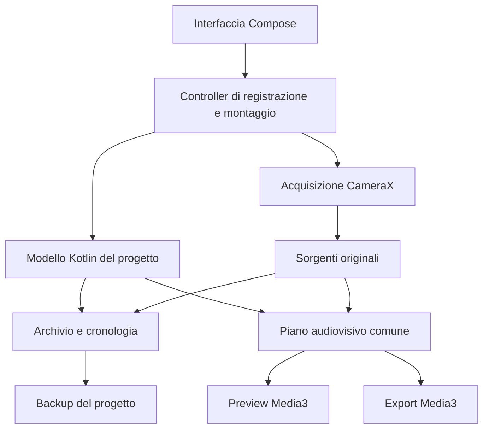

# Piano di sviluppo della versione Android derivata da YouRec

Data: 16 novembre 2026. Destinatario: Fabrizio Panebarco. Dispositivo iniziale: il suo Samsung S26. Nome di lavoro interno: **Creator Android**, da sostituire prima della distribuzione pubblica.

Nota di aggiornamento: questo documento conserva il piano iniziale e le sue ipotesi. Il fork e la prima app personale 0.1.0 sono stati successivamente realizzati; lo stato attuale è in [STATUS.md](STATUS.md), le prove in [EVIDENCE.md](EVIDENCE.md), le decisioni di implementazione in [CONTRACT.md](CONTRACT.md). In particolare, il formato effettivo usa microsecondi interi, il cambio camera avviene fra segmenti e l'accettazione fisica sul S26 resta aperta.

L'obiettivo è una videocamera con montaggio rapido, utilizzabile offline sul telefono: registrare, continuare una ripresa in momenti diversi, correggere il montaggio ed esportare un video senza perdere gli originali. La prima consegna utile è un APK personale con questo percorso completo. Effetti avanzati, doppia camera e AI vengono aggiunti su una base già verificata.

Il piano assume priorità equilibrata fra registrazione e montaggio essenziale. Le scelte di prodotto, i tempi e i criteri di accettazione qui indicati sono proposte; i fatti sulle API e sul repository sono accompagnati dalle relative fonti. La compatibilità effettiva del S26 deve ancora essere misurata.

## 1. Base di partenza e strategia del fork

Il riferimento è [antirez/YouRecApp](https://github.com/antirez/YouRecApp), fissato per questa analisi al commit [faf1815e82e1f2d5f03034a583363d3c3af464a2](https://github.com/antirez/YouRecApp/commit/faf1815e82e1f2d5f03034a583363d3c3af464a2). Il progetto principale contiene 105 file Swift, due shader Metal e un componente C++ di stima del movimento; nell'albero esaminato non è presente un progetto Android. Questo conteggio descrive i file applicativi, escludendo test e dipendenze, e non misura la percentuale di codice riutilizzabile. [Albero del repository](https://github.com/antirez/YouRecApp/tree/faf1815e82e1f2d5f03034a583363d3c3af464a2/YouRec)

La licenza MIT permette il lavoro derivato mantenendo copyright e licenza. Il file riserva espressamente nome e icona YouRec; la nostra app avrà nome, icona e identificativo Android propri. Le dipendenze e i pesi dei modelli mantengono le loro licenze. Non copieremo il contatto privacy dell'autore o presenteremo la nostra app come sua versione ufficiale. [Licenza](https://github.com/antirez/YouRecApp/blob/faf1815e82e1f2d5f03034a583363d3c3af464a2/LICENSE), [attribuzioni](https://github.com/antirez/YouRecApp/blob/faf1815e82e1f2d5f03034a583363d3c3af464a2/THIRD_PARTY_NOTICES.md)

All'avvio dello sviluppo:

1. Creare il fork nell'account GitHub scelto, conservando storia e provenienza. Un fork GitHub di questo repository pubblico sarà pubblico; se in seguito fosse richiesta riservatezza, servirà un repository separato secondo le regole della piattaforma. [Visibilità dei fork](https://docs.github.com/en/pull-requests/reference/forks)
2. Usare `upstream` per Antirez e `origin` per il nostro repository, con un ramo di sviluppo `android/main` e una cartella `android/` dedicata.
3. Tenere `UPSTREAM.md` con commit di partenza, componenti tradotti e attribuzioni. Proposta: mantenere MIT anche per il nostro codice originale.
4. Importare intenzionalmente correzioni o algoritmi utili dall'upstream, verificandoli sul modello Android. Una modifica Swift non diventa automaticamente una modifica Kotlin equivalente.
5. Separare build iOS e Android. Gli asset Apple, i modelli Core ML e le dipendenze iOS non entrano automaticamente nell'APK.

Il nome definitivo e l'application ID vanno fissati prima di distribuire la prima beta da usare con progetti reali. La pianificazione attuale non ha ancora creato il fork o un'app compilata.

## 2. Cosa recuperiamo dal lavoro originale

| Area | Elementi di riferimento | Strategia Android |
| --- | --- | --- |
| Modello dei progetti | `Project.swift`, `ProjectStore.swift`, `ProjectRecovery.swift` | Tradurre struttura e invarianti; conservare sorgenti immutabili, cronologia e recupero transazionale |
| Montaggio | `TrackTimeline.swift`, `TimelineEditing.swift`, test relativi | Portare operazioni e casi limite in Kotlin puro, adattando le integrazioni Android |
| Registrazione | `CaptureController.swift`, `CaptureSegmentWriter.swift`, `CaptureAudio.swift` | Riprendere i comportamenti; implementare con CameraX e verificare sul telefono |
| Preview ed export | `MediaRenderer.swift`, `TrackRenderer.swift` | Nuova integrazione Media3, guidata dallo stesso modello di montaggio |
| DSP semplice | `AudioDSP.swift` | Tradurre gain, filtri ed EQ; confrontare numericamente i risultati |
| Riduzione rumore | RNNoise in `ThirdParty/` | Valutare riuso C tramite NDK/JNI, con licenze e test numerici |
| Stabilizzazione offline | `StabilizationMotion.cpp`, `StabilizationPath.swift` | Il nucleo C++ è candidato al riuso; decodifica, applicazione della correzione e GPU richiedono lavoro Android |
| Effetti video | `VideoEffects/`, shader Metal | Recuperare algoritmi, parametri e palette; riscrivere l'esecuzione GPU e sostituire le funzioni Apple Vision |
| Sottotitoli | `Subtitles.swift`, `SubtitleSpeech.swift`, runtime Qwen MLX | Portare il modello editoriale; scegliere e misurare un runtime Android per il riconoscimento |
| Modelli vocali avanzati | Core ML DeepFilterNet3, LavaSR, VoiceFixer | Ripartire da modelli e conversioni compatibili; nessuna esecuzione diretta dei pacchetti Core ML |

Questa è una valutazione del lavoro da svolgere, non una dichiarazione di compatibilità binaria. Il vantaggio del repository è soprattutto nelle decisioni di prodotto, negli algoritmi, nelle regole di integrità e nei test già identificati. [Sorgenti applicativi](https://github.com/antirez/YouRecApp/tree/faf1815e82e1f2d5f03034a583363d3c3af464a2/YouRec), [test](https://github.com/antirez/YouRecApp/tree/faf1815e82e1f2d5f03034a583363d3c3af464a2/Tests), [provenienza Qwen](https://github.com/antirez/YouRecApp/blob/faf1815e82e1f2d5f03034a583363d3c3af464a2/ThirdParty/QwenASR/PROVENANCE.md)

## 3. Funzioni e rilasci

### Versione 0.1 personale

La prova di utilità sarà questa: registrare A, mettere in pausa, registrare B, chiudere il progetto, riaprirlo e aggiungere C; tagliare una frase, spostare una clip, annullare e ripristinare una modifica, esportare e condividere il video. Il progetto deve rimanere modificabile dopo l'export.

| Funzione | Comportamento previsto nella 0.1 |
| --- | --- |
| Registrazione | Camera frontale o posteriore, audio, avvio, pausa, ripresa, stop e continuazione di un progetto |
| Qualità | Profilo iniziale richiesto 1080p/30 fps SDR; verificare profilo e codec realmente negoziati |
| Controlli camera | Zoom, tap per fuoco/esposizione e blocco dove supportato; mostrare solo opzioni effettivamente disponibili |
| Cambio camera | Sempre selezionabile fra riprese; durante la ripresa solo se supera la prova iniziale di continuità |
| Progetti | Creazione, nome, durata, miniatura, riapertura, originali e cestino ripristinabile |
| Importazione | Video selezionati tramite picker, copiati nel progetto; percorso di base MP4 H.264/AAC e gestione esplicita dei file non supportati |
| Editor | Un montaggio video sequenziale con audio collegato, miniature, waveform, scrub, split, trim, cancellazione e riordino |
| Audio | Muto e volume per clip; nessun distacco accidentale dall'immagine durante i tagli |
| Cronologia | Undo/redo persistenti; una gesture completata costituisce una modifica |
| Formato video | 9:16 o 16:9 impostato per progetto; inquadratura coerente fra preview ed export, fit come default |
| Export | Nuovo MP4 H.264/AAC SDR, avanzamento, annullamento, salvataggio in galleria e condivisione |
| Backup | Archivio del nostro progetto con originali e cronologia, verificato con importazione di ripristino |
| Interfaccia | Italiano, tema scuro, portrait e landscape, pulsanti leggibili e accessibili |
| Dati | Elaborazione locale, nessun account necessario; sorgenti protette dalle operazioni di montaggio |

La beta 0.1 non dipende dalla riuscita del cambio camera continuo: se la prova fallisce, la funzione viene rinviata e la camera si cambia fra segmenti. Non sarà presentata come disponibile durante REC.

### Versioni successive

| Rilascio | Obiettivo | Contenuti |
| --- | --- | --- |
| 0.2 | Montaggio per creator | Titoli, immagini e foto, musica su una traccia separata, fade audio, crop, velocità, LUT e correzione colore di base; transizioni solo dopo verifica preview/export |
| 0.3 | Registrazione avanzata | 4K e frame rate aggiuntivi misurati, microfoni esterni, memoria zoom/fuoco, segnalibri, doppia camera PiP se supportata |
| 0.4 | Parlato offline | Sottotitoli correggibili ed esportabili, riduzione rumore RNNoise, analisi delle pause con anteprima delle parti da tagliare |
| 1.0 | Uso quotidiano consolidato | Stabilità, aggiornamenti che preservano i progetti, help, accessibilità, firma stabile e matrice dei dispositivi effettivamente provati |
| Estensioni | Funzioni da valutare singolarmente | Stabilizzazione offline, face tracking, DeepFilterNet3/LavaSR/VoiceFixer, HDR completo, effetti complessi e interscambio con altri editor |

L'ordine di 0.3 e 0.4 può cambiare se l'uso reale rende più importante la doppia camera o il parlato. La 1.0 indica solidità del perimetro concordato, non equivalenza con ogni funzione iOS.

## 4. Esperimenti iniziali che decidono l'architettura

### A. Camera e continuità sul S26

Un APK diagnostico rileverà modello esatto, versione Android/One UI, camere esposte, qualità, frame rate, gamma dinamica, stabilizzazione, ingressi audio, codec e combinazioni concorrenti. Il report conterrà dati tecnici, senza identificativi personali o riprese.

CameraX documenta `asPersistentRecording()`, che mantiene la registrazione e l'audio durante il riaggancio a un'altra camera. L'API è sperimentale e non garantisce che il nuovo flusso sia compatibile né la durata del passaggio visivo. La priorità è provare questa strada prima di costruire un motore custom. [PendingRecording](https://developer.android.com/reference/androidx/camera/video/PendingRecording)

Confrontare **CameraX 1.6.2 stabile e 1.7.0-rc02** in build diagnostiche distinte: il ramo 1.7 documenta correzioni per HDR sul S26, pausa/ripresa nel cambio camera e perdita di thread durante unbind. La scelta sarà basata sulle prove; registrare anche il numero di thread dopo cambi ripetuti. [Correzioni CameraX](https://developer.android.com/jetpack/androidx/releases/camera#1.7.0-alpha03)

Prova proposta: 20 cambi frontale/posteriore in 1080p SDR, registrando parlato e riferimenti audiovisivi; confronto della preview e del file salvato. Obiettivi iniziali: nessuna parola persa, nessun salto temporale dell'audio, sincronizzazione entro un fotogramma e fermo immagine al cambio non superiore a 500 ms. Sono soglie di progetto da misurare e, per il fermo immagine, da confermare come accettabili nell'uso.

Se fallisce: mantenere cambio in pausa. Un percorso Camera2 con gestione autonoma di audio, timestamp e composizione richiede una decisione e una stima aggiuntive; non entra implicitamente nel budget della prima versione.

### B. Editor ed export con lo stesso risultato

Creare una composizione di tre clip con tagli non coincidenti con keyframe, un input ruotato, uno senza audio e variazioni di volume. Confrontare riproduzione e MP4 esportato. Aggiungere un titolo e una traccia musicale solo come prove per la fase successiva.

Media3 permette di usare una `Composition` per preview con `CompositionPlayer` ed export con `Transformer`; la preview è ancora annotata sperimentale. La documentazione distingue sequenze singole supportate e multi-video ancora in sviluppo. La versione candidata è **Media3 1.11.1**, indicata stabile nella tabella consultata il 16 novembre 2026; gli adattatori useranno solo le API effettivamente presenti nella versione fissata. [CompositionPlayer](https://developer.android.com/media/media3/transformer/compositionplayer), [Media3 release](https://developer.android.com/jetpack/androidx/releases/media3)

Se la preview scelta presenta blocchi: valutare una playlist ExoPlayer con mapping temporale comune per il perimetro essenziale, oppure proxy renderizzati per gli effetti interessati. Limitare il perimetro finché preview ed export non coincidono; evitare un secondo modello di montaggio indipendente.

### C. Interruzioni e recupero

Uccidere il processo in momenti controllati durante registrazione, finalizzazione, import, salvataggio della cronologia ed export. Misurare cosa si recupera e quanto materiale recente può mancare. La robustezza del manifest e quella di un file video ancora aperto sono proprietà diverse.

Le release CameraX 1.6 descrivono miglioramenti del muxer per la resilienza alle interruzioni; questi vanno verificati sul percorso selezionato. Un file presente su disco non prova che sia decodificabile. [Note CameraX](https://developer.android.com/jetpack/androidx/releases/camera), [evento Finalize](https://developer.android.com/reference/androidx/camera/video/VideoRecordEvent.Finalize)

Criterio minimo: nessuna perdita dei segmenti già finalizzati e delle modifiche confermate; gestione esplicita della ripresa interrotta. Se il recupero della ripresa aperta non è sufficiente per l'uso concordato, introdurre registrazione frammentata o checkpoint verificati come lavoro dedicato. Non interrompere periodicamente la camera creando buchi nascosti per simulare questa garanzia.

## 5. Architettura proposta

La base è nativa Android: Kotlin e Jetpack Compose per l'interfaccia, CameraX per acquisizione, Media3 per riproduzione ed export, Kotlin puro per il modello dei progetti. Il codice C/C++ entra tramite NDK soltanto nelle funzioni che ne beneficiano, come RNNoise o un runtime ASR.

| Modulo iniziale | Responsabilità e confine |
| --- | --- |
| `:app` | Schermate, navigazione, permessi e coordinamento; niente regole della timeline dentro i composable |
| `:domain` | Identità, tempo, clip, comandi di montaggio, validazione, cronologia e descrizione del render; testabile sulla JVM |
| `:data` | File, manifest, import, backup e recupero; espone operazioni di progetto complete |
| `:media` | CameraX, Media3, profili hardware, audio e generatori di miniature/waveform; nasconde lifecycle e API sperimentali |

Quattro moduli sono sufficienti all'inizio. DSP, ASR o GPU possono essere estratti quando arrivano le relative funzioni. Il dominio non dipende da `Context`, `Uri`, classi CameraX o oggetti Media3 serializzati.

Impostazioni iniziali proposte: `minSdk 31` per limitare il supporto ai sistemi recenti, `compileSdk`/`targetSdk` stabili disponibili e compatibili all'avvio, supporto verificato inizialmente sul solo S26. Il requisito minimo Android non equivale alla certificazione di tutti i telefoni con quella versione. Toolchain JDK/Gradle/AGP/Kotlin/Compose fissata come insieme compatibile, Gradle Wrapper, version catalog e verifica delle dipendenze; nessuna versione dinamica.

Nel Mac sono stati rilevati `adb` e la cartella standard dell'SDK. La completezza di piattaforme SDK, JDK, build tools e strumenti di firma resta una verifica della fase iniziale; non è stata eseguita una build Android.

### Modello dei dati e tempi

Entità principali: `Project`, `SourceAsset`, `TimelineClip`, `EditSnapshot`, `CaptureLedgerEntry`, `RenderPlan` ed `ExportReceipt`. Ogni asset ha ID stabile, posizione relativa, metadati, durata, orientamento e impronta SHA-256; i checksum delle riprese si calcolano fuori dal percorso critico della registrazione.

La timeline usa intervalli semiaperti e tempo intero, proponendo la scala di 240.000 tick/s già adottata dall'originale. I timestamp delle sorgenti restano distinti, soprattutto per input a frame rate variabile; conversioni verso i microsecondi Media3 arrotondano i confini cumulativi, con controlli di overflow. Non si identifica un istante di sorgente moltiplicando semplicemente un frame rate nominale. [Modello temporale upstream](https://github.com/antirez/YouRecApp/blob/faf1815e82e1f2d5f03034a583363d3c3af464a2/YouRec/TrackTimeline.swift)

Formato Android proprio, versionato. In seguito si potrà costruire un importatore dei progetti YouRec o un export OpenTimelineIO con un sottoinsieme dichiarato. Il nostro ZIP iniziale non è promesso come compatibile con l'app iOS; ignorare effetti sconosciuti senza avviso produrrebbe montaggi diversi.

### Persistenza e conservazione degli originali

Un progetto contiene manifest, sorgenti, snapshot immutabili, registro delle acquisizioni, cache rigenerabili e ricevute di export. Il manifest è l'autorità del progetto; un eventuale indice della libreria rimane ricostruibile, senza una seconda copia divergente della timeline.

Ogni modifica pubblica i nuovi snapshot e sostituisce atomicamente il manifest solo dopo le scritture necessarie. Conservare più revisioni precedenti; riconciliare file orfani e transazioni interrotte all'apertura. Validare schema, riferimenti e intervalli, rifiutando gli schemi futuri con un messaggio leggibile.

Le nuove riprese si registrano in un ledger distinto dalla cronologia di montaggio, seguendo la semantica originale: fare Undo non deve eliminare automaticamente una ripresa appena aggiunta, e registrare dopo Undo non deve distruggere Redo. Una cancellazione esplicita dalla timeline rimane annullabile. [Project.swift](https://github.com/antirez/YouRecApp/blob/faf1815e82e1f2d5f03034a583363d3c3af464a2/YouRec/Project.swift)

La pulizia automatica riguarda cache temporanee riconoscibili. Originali ancora presenti nel progetto o raggiungibili dalla cronologia non vengono eliminati per recuperare spazio. Il cestino conserva il progetto fino a svuotamento esplicito. L'archivio di backup include sorgenti e cronologia, verifica checksum e respinge percorsi ZIP che escono dalla destinazione, collisioni o dimensioni oltre il limite concordato.

### Registrazione e risorse

Stati espliciti: pronto, avvio, registrazione, finalizzazione, pausa ed errore. Un solo comando camera per volta; le azioni durante avvio/finalizzazione non devono creare doppie registrazioni. La UI mostra REC dopo l'evento di avvio effettivo.

Per avere punti di salvataggio chiari, la prima implementazione propone che Pausa finalizzi un segmento e Riprendi ne inizi un altro nello stesso progetto. Il tempo trascorso in pausa non entra nel montaggio. Usare solamente `Recording.pause()` dentro un unico file non equivale a creare un segmento già finalizzato. Stop permette di continuare in futuro, anche dopo riavvio.

Registrazione iniziale con schermata visibile e schermo mantenuto acceso. Quando l'app perde le condizioni necessarie, arrestare e finalizzare esplicitamente; non ripartire automaticamente dopo una chiamata o il ritorno in primo piano. Se si usa persistent recording, chiuderlo esplicitamente anche quando il lifecycle smette di produrre video.

Orientamento e profilo si fissano per ripresa. La preview selfie può essere specchiata senza imporre lo stesso comportamento al file; entrambe le scelte si verificano. Prima di registrare si sospendono analisi e render pesanti concorrenti. Spazio insufficiente o temperatura critica producono uno stato comprensibile, senza cambiare qualità o cancellare originali di nascosto.

### Rendering, export e background

Un compilatore del progetto costruisce un `RenderPlan` dalla revisione congelata, poi l'adattatore genera la composizione Media3. Crop, orientamento, effetti e volumi derivano da questa descrizione comune. Il cambio di scala dell'interfaccia o lo zoom d'ispezione non modificano il video esportato.

Export in file temporaneo, verifica di contenitore, tracce e durata, pubblicazione solo a completamento. La ricevuta registra revisione, profilo, risultato e destinazione; l'utente può condividere nuovamente lo stesso export. I tagli precisi possono richiedere ricodifica: nessuna promessa di taglio arbitrario senza ricodifica.

Per lavori lunghi avviati dall'utente si prevede un foreground service appropriato alla versione Android, con avanzamento e annullamento. `mediaProcessing` si usa sui sistemi che lo supportano; il percorso per le API precedenti va validato prima di dichiararne il supporto. Timeout e interruzione persistono lo stato del lavoro. La prima versione può riavviare un render interrotto dall'inizio, conservando cache già validate. WorkManager rimane utile per attività differibili, senza presumere esecuzione illimitata. [Foreground service](https://developer.android.com/develop/background-work/services/fgs/service-types), [worker lunghi](https://developer.android.com/develop/background-work/background-tasks/persistent/how-to/long-running)

## 6. Interfaccia e percorso d'uso

Tre destinazioni principali:

1. **Registra.** Preview ampia, REC/Pausa/Stop raggiungibili con una mano, durata registrata, ingresso audio e qualità attiva. Gli strumenti avanzati si aprono con un pannello; le limitazioni si spiegano quando si seleziona la funzione interessata.
2. **Progetti.** Schede con titolo, miniatura e durata. Azioni chiare: continua a registrare, monta, condividi, backup e cestino. Originali e video esportato sono distinguibili.
3. **Editor.** Preview nella parte superiore, timeline con miniature e waveform, playhead e strumenti contestuali nella parte inferiore. Play/pausa, Undo/Redo ed export restano facili da raggiungere.

Scrub ferma la riproduzione; il rilascio non la riavvia senza comando. Split opera sul playhead, trim mantiene il legame audio/video e l'anteprima del taglio permette di ascoltare la giunzione. I formati misti usano fit/letterbox di default, evitando ritagli non richiesti. Titoli e controlli rispettano safe area e dimensione caratteri del sistema.

Test pratico di usabilità: senza istruzioni esterne, Fabrizio deve poter registrare due spezzoni, rimuovere un errore, annullare un taglio ed esportare. Questo test si esegue prima di ampliare il catalogo degli effetti.

## 7. Funzioni avanzate con verifiche dedicate

**Doppia camera.** Interrogare `availableConcurrentCameraInfos`, poi verificare preview e file nel profilo selezionato. La prima implementazione PiP può registrare un unico video già composto: il riquadro sarà incorporato nella sorgente e non liberamente riposizionabile dopo la ripresa. Due sorgenti indipendenti e un layout rieditabile sono un'altra funzione, con costi di registrazione, sincronizzazione, storage ed editor multi-video. Verificare anche il mirroring specifico della composizione. [Camera provider](https://developer.android.com/reference/androidx/camera/lifecycle/ProcessCameraProvider)

Le API per modificare dinamicamente il layout PiP e scegliere esplicitamente i MIME di acquisizione sono aggiunte del ramo 1.7: non presumere che esistano nella 1.6.2. [Aggiunte CameraX 1.7](https://developer.android.com/jetpack/androidx/releases/camera#1.7.0-alpha02)

**4K, HDR e Log.** Sbloccare i profili per combinazione camera/qualità/frame rate. Testare separatamente acquisizione HDR ed export HDR; per input HDR nel progetto SDR proporre conversione esplicita e validata o segnalare l'incompatibilità. Un filtro non sostituisce l'acquisizione Log. Il piano non presume accesso alle funzioni proprietarie della camera Samsung né equivalenza con Apple Log. [Formati e HDR Media3](https://developer.android.com/media/media3/transformer/supported-formats)

**Sottotitoli offline.** Primo candidato di prova: `whisper.cpp` con modello multilingue piccolo/base, per il quale esiste un esempio Android. È una scelta da confrontare su parlato italiano reale, rumore, nomi propri e tempi; non una promessa di accuratezza o velocità. Il runtime Qwen MLX del repository non viene trasferito direttamente. Si deciderà il modello finale dopo misure di qualità, memoria, consumo e tempo. [Esempio Android whisper.cpp](https://github.com/ggml-org/whisper.cpp/blob/master/examples/whisper.android/README.md)

Scaricamento del modello solo su richiesta, con dimensione, licenza, checksum, annullamento e rimozione. Una volta installato, trascrizione in modalità aereo; segmenti correggibili, tempi legati alla sorgente, esportazione SRT e sovrimpressione sul video. Eventuali tempi parola approssimativi saranno identificati come tali.

**Audio.** Gain, filtro passa-alto ed EQ prima; RNNoise poi. Elaborazione sul contesto della sorgente, cache identificata da checksum/parametri/versione e confronto bypass/elaborato. Per DeepFilterNet3, LavaSR e VoiceFixer serve una prova separata di conversione e inferenza: scegliere runtime Android, verificare licenza dei pesi, artefatti udibili, RAM e temperatura. La somiglianza con l'output iOS va misurata.

**Codice nativo.** Le librerie NDK e le dipendenze precompilate dovranno supportare le pagine di memoria da 16 KB; validare APK e `.so`, senza presumere la configurazione del S26. [Guida Android](https://developer.android.com/guide/practices/page-sizes)

## 8. Fasi, dipendenze e criteri di uscita

Le giornate sono stime iniziali di lavoro tecnico a tempo pieno, comprensive delle verifiche indicate, non una previsione della durata di una sessione dell'assistente. Il telefono deve essere disponibile per le prove; i tempi si rivedono dopo F0.

| Fase | Lavoro | Risultato verificabile | Impegno indicativo |
| --- | --- | --- | --- |
| F0 | Fork, toolchain, APK diagnostico; prove camera, preview/export e interruzioni | Report S26, dipendenze fissate e decisioni sui tre esperimenti | 4–7 giorni |
| F1 | Modello, archivio, cronologia e recorder essenziale | Alpha: A/Pausa/B/Stop, riapertura e continuazione con C; segmenti salvati verificati | 8–12 giorni |
| F2 | Timeline, import, operazioni di montaggio, volume, preview ed export | Un progetto reale viene montato ed esportato correttamente; Undo/Redo sopravvive alla riapertura | 10–16 giorni |
| F3 | Cestino, backup/ripristino, interruzioni, performance e aggiornamenti | Beta 0.1 firmata, installabile e utilizzabile con i criteri della sezione 9 | 5–8 giorni |
| F4 | Editor 0.2 | Titoli, musica ed effetti selezionati con equivalenza preview/export | 8–15 giorni aggiuntivi |
| F5 | Camera 0.3 | Profili avanzati e PiP abilitati solo dove validati | 6–12 giorni aggiuntivi, se F0 conferma il percorso standard |
| F6 | Parlato 0.4 | Trascrizione italiana offline e riduzione rumore misurate sul dispositivo | 10–20 giorni aggiuntivi |
| F7 | Consolidamento 1.0 | Regressioni chiuse, aggiornamenti, accessibilità e documentazione | 5–10 giorni aggiuntivi |

F0–F3 richiedono indicativamente **27–43 giornate**, oppure **34–54 con una riserva del 25%** arrotondata. Con una persona dedicata cinque giorni a settimana, l'ordine di grandezza è **7–11 settimane per la beta personale**. Il primo APK diagnostico e l'alpha arrivano prima. Attese per il telefono, ampliamenti di scope, un motore Camera2 custom e recupero avanzato della ripresa aperta non sono assorbiti da questa stima.

L'assistenza alla scrittura del codice può ridurre il lavoro di implementazione; non elimina prove di durata, ascolto, aggiornamenti e differenze del firmware. Non fissiamo una data per la parità completa con YouRec: ogni estensione ha un proprio esperimento e una propria stima.

Percorso critico: F0 → F1 → F2 → F3. La doppia camera, i modelli grandi e gli effetti GPU non bloccano il primo percorso completo registrazione–montaggio–export.

## 9. Piano di verifica sul telefono

I valori seguenti sono obiettivi iniziali, da confermare con le misure F0. Un test sul simulatore o una build riuscita non certificano sensori, audio o file salvati.

| Area | Prova di accettazione |
| --- | --- |
| Percorso principale | A+B+C dopo pausa, stop e riapertura; nessuna duplicazione e nessun tempo di pausa incluso |
| Preview e file | Stessa inquadratura prevista, rotazione corretta, mirroring verificato con testo in scena |
| Durata | Sessione continua da 30 minuti nell'alpha; 60 minuti per la beta, con registrazione di temperatura, frame e memoria |
| Sincronizzazione | Riferimenti visivi e sonori a inizio/fine e ai cambi; scarto entro un frame a 30 fps, senza deriva cumulativa |
| Cambio camera | 20 cambi per coppia/profilo abilitati, misurando separatamente audio, fermo immagine e sync |
| Montaggio | Confini di clip, tagli ravvicinati, silenzio, clip senza audio, 100 operazioni miste e confronto della timeline attesa |
| Cronologia | Undo, chiusura, riapertura, Redo; nuova ripresa dopo Undo; edit divergente sostituisce solo il ramo Redo abbandonato |
| Import | Video lunghi, ruotati, frame rate variabile, codec non supportato, picker annullato e media cloud non ancora scaricato |
| Integrità | SHA-256 degli originali identici prima/dopo tagli, export, Undo e ripristino |
| Export | Durata, tagli e volumi coerenti; MP4 aperto nella galleria e in un secondo player; annullamento e nuovo tentativo |
| Interruzioni | Chiamata, blocco schermo, cambio app, perdita del microfono, permessi revocati, spazio insufficiente e kill del processo |
| Backup e upgrade | Restore in un'installazione di test e aggiornamento APK firmato senza perdita di progetti |
| Privacy | Montaggio e registrazione in modalità aereo; per ASR, prova offline dopo download; nessun media nei log diagnostici |
| Usabilità | Uso con una mano, orientamenti, testo ingrandito, navigazione TalkBack e pulsanti non coperti dalle barre di sistema |

Test automatici: unitari JVM per operazioni e invarianti della timeline; casi derivati dai test upstream; test di persistenza con interruzioni in punti definiti; test strumentali su media campione e flussi UI. Encoder differenti non sono confrontati byte per byte: si confrontano durata, timestamp, immagini campione, audio e metadati con tolleranze dichiarate.

Ogni evidenza contiene build, modello, sistema/firmware, profilo richiesto ed effettivo, risultato e campioni di prova. I test usano progetti dedicati; aggiornamenti e pulizie non devono cancellare i progetti reali. Prima della beta: nessun difetto aperto di perdita dati, originali alterati, export corrotto o sincronizzazione fuori soglia sul percorso supportato.

## 10. Rischi e risposta prevista

| Rischio | Come lo riduciamo | Cosa cambia se resta aperto |
| --- | --- | --- |
| Camera diversa da quanto suggerisce la scheda commerciale | Inventario e acquisizioni reali per combinazione | Ridurre profili/camere esposti, con indicazione chiara |
| Cambio camera con gap o errori | Persistent recording e misure all'inizio | Cambio fra riprese; motore custom come estensione stimata |
| Preview complessa instabile | Perimetro sequenziale, adattatore isolato, versioni fissate | Proxy o scope ridotto; rinviare multi-video |
| Ripresa aperta danneggiata dopo crash | Checkpoint a pausa/stop e prove sul muxer scelto | Dichiarare finestra di perdita misurata; lavoro aggiuntivo per migliorarla |
| Perdita della cronologia o di originali | Snapshot, transazioni, ledger separato e test di recupero | Blocco del rilascio personale con progetti reali |
| RAM, temperatura e batteria | Ridurre concorrenza, cache limitate, test lunghi | Disabilitare combinazioni troppo pesanti |
| AI lenta o poco accurata in italiano | Benchmark con campioni e confronto di modelli | Modello più piccolo o funzione rinviata |
| Audio esterno variabile | Test con il microfono effettivamente usato | Supporto limitato ai percorsi verificati |
| Dipendenze o pesi inadatti alla distribuzione | Inventario versioni, licenze e attribuzioni fin dall'import | Sostituire il componente prima del rilascio |
| Evoluzione dell'upstream | Commit di riferimento e porting selettivo | Aggiornamenti intenzionali, senza inseguire ogni nuova funzione |

## 11. Permessi, installazione e manutenzione

Camera e microfono si richiedono quando si entra nel relativo flusso. Un rifiuto non deve bloccare importazione e montaggio; una registrazione senza audio richiede una scelta esplicita e un'indicazione visibile. Per importare usare Photo Picker/Storage Access Framework, evitando accesso indiscriminato ai file; un provider cloud può richiedere rete solo per ottenere il file scelto. [Photo Picker](https://developer.android.com/training/data-storage/shared/photo-picker)

Originali gestiti dall'app, esportazioni in storage condiviso e backup scelto dall'utente. Le directory private possono essere eliminate con la disinstallazione: l'app deve rendere disponibile il backup del progetto e distinguere archivio modificabile da video esportato. La pubblicazione in MediaStore avviene solo dopo il completamento. [Storage dei media](https://developer.android.com/training/data-storage/shared/media)

Il ciclo iniziale usa APK e ADB su dispositivo autorizzato, senza bisogno del Play Store. La documentazione Android mantiene questo percorso di sviluppo fuori dalla verifica sviluppatore per distribuzione; l'eventuale distribuzione pubblica va riesaminata al momento del rilascio. [FAQ Android developer verification](https://developer.android.com/developer-verification/guides/faq)

La beta personale avrà application ID stabile e chiave di firma conservata fuori dal repository con backup sicuro. Build di prova distruttive useranno un ID separato. La pipeline produce APK, checksum, note di versione e risultati dei test; l'aggiornamento della beta si installa sopra la versione precedente. Un AAB, Play App Signing, scheda store e requisiti correnti di pubblicazione appartengono alla futura distribuzione pubblica.

Costi iniziali principalmente di sviluppo e test: nessun backend o servizio AI a consumo è richiesto dall'architettura. Hosting di modelli, CI, account di distribuzione ed eventuali telefoni aggiuntivi si valutano quando necessari, senza acquistare servizi per il solo piano.

## 12. Primo backlog operativo

| ID | Attività | Dipende da | Consegnabile |
| --- | --- | --- | --- |
| AND-01 | Preparare fork, provenienza, nome interno e licenze | — | Repository e struttura Android |
| AND-02 | Verificare toolchain e fissare build/dipendenze | AND-01 | APK vuoto riproducibile e CI |
| AND-03 | Implementare diagnostica camera/audio/codec | AND-02 | Report capabilities del S26 |
| AND-04 | Confrontare CameraX stabile/RC per acquisizione e cambio camera | AND-03 | Video, misure della continuità e scelta motivata della versione |
| AND-05 | Provare composizione, preview ed export | AND-02 | Campioni confrontati e scelta dell'adattatore |
| AND-06 | Provare interruzioni e recupero della registrazione | AND-04 | Finestra di perdita e comportamento definiti |
| AND-07 | Portare modello temporale, clip e operazioni essenziali | AND-01 | Modulo Kotlin e test delle invarianti |
| AND-08 | Implementare archivio, cronologia e capture ledger | AND-07 | Salvataggio e recupero verificati |
| AND-09 | Collegare recorder e libreria progetti | AND-04, AND-06, AND-08 | Alpha con continuazione A+B+C |
| AND-10 | Costruire editor e import dei media | AND-05, AND-08 | Tagli, trim, riordino, volume, Undo/Redo |
| AND-11 | Completare export, condivisione e gestione lavori | AND-10 | MP4 verificato e annullamento affidabile |
| AND-12 | Backup, restore, cestino, prove lunghe e aggiornamento | AND-09, AND-11 | Beta 0.1 personale |

Le prime decisioni che richiedono il telefono sono modello/firmware effettivi, profili camera e resa dei cambi. Il nome finale, il microfono esterno da supportare e un'eventuale pubblicazione pubblica possono essere definiti durante lo sviluppo senza fermare la preparazione tecnica. Collegamento USB o debug wireless autorizzato serviranno per le prove reali; finché mancano, restano eseguibili build, test del dominio e campioni di editing, ma non la certificazione camera.

La ricerca sulle API, con ulteriori dettagli e fonti, è conservata in [ANDROID-FEASIBILITY.md](ANDROID-FEASIBILITY.md).
